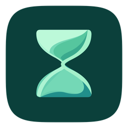

<div align="center">
  

# 时织 · Dayweave

**将待办计划、时间记录、目标、课表与跨设备同步整合在一起的本地优先应用**

[下载 Releases](https://github.com/AlexbeatsZ/dayweave/releases) · [独立 Server](server/README.md) · [AI API](docs/api/README.md) · [设计文档](docs/design/architecture.md) · [MIT 许可](LICENSE)
</div>

## 项目介绍

时织（Dayweave）整合了本人开源的 [Clearlist](https://github.com/AlexbeatsZ/clearlist) 待办系统和 [Open Timelog](https://github.com/AlexbeatsZ/open-timelog) 时间记录领域能力，并增加课表、目标、设备使用记录、加密同步及 AI 接口。Windows、macOS 和 Android 使用共用的 React/TypeScript 业务界面，并通过 Electron、Capacitor 与对应原生组件接入系统。

数据优先保存在设备本地；**不依赖云账号**。单设备可独立运行，需要多设备时再配置可控的同步中心。

## 核心特色与功能

### 1. 待办：按日期组织，而不是自动替你结转

- **三种任务视图**：**日视图、总视图、待办箱**。日视图查看指定日期的实际任务，总视图显示尚未完成且计划在今天/未来/待定的任务；无日期的任务进入待办箱。
- **一个任务可安排多个日期**：每个日期可以独立关联当日时段；快速选择今天、明天、待定（∞）、无日期，也可通过可反选的多选月历安排多天。没有强制的开始/结束日期，也不会自动滚动结转过期任务。
- **任务属性**：清单、标签、备注、预计用时、实际用时、手动设置的简单/中等/困难等级、排序和子任务；难度**不由预计用时自动推断**。
- **父子完成与历史**：子任务有独立的完成/撤销记录，父子状态关联；查看历史日期时保留当日发生的完成事实。
- **重复任务**：既支持提前创建有限个连续编号的实例，也支持由同步中心按五字段 **Cron** 规则生成未来实例。总视图仅投影符合条件的当前实例，不将整条重复链展开成一大串任务。不会因为删除实例自动重造历史任务。

任务体系与数据迁移的精确定义见 [任务设计](docs/design/task-system.md)。当前本地源码准备 **0.5.4** 的桌面拖动交互更新；**已确认交付的客户端基线为 0.5.3 / 同步中心 0.2.1**，不要仅凭源码版本认定某设备已经安装新版。

### 2. 记录：计时、时间线与目标

- **活动计时**：同一活动既能正计时，也能设置截止时间倒计时；支持开始/结束时间修正、暂停、标签、任务关联，以及“结束当前并开始下一活动”。
- **手动与自动时间线**：日期连续加载；手动记录、设备自动观察及对照视图分开呈现，自动采集不会伪装成手动记录。
- **活动与目标**：按活动、标签及排除条件定义每日/每周计时目标；支持“至少/不超过”、阶段阈值、排序与统计热力图。
- **脚本目标**：可通过内置模板或导入 JavaScript 模块自定义周期判定，脚本在隔离的 QuickJS 环境执行；已配对时由同步中心计算结果再同步给所有设备。接口、参数和边界见 [目标脚本规范](docs/goal-scripts.md)。
- 不再采用独立番茄钟模式；计时归属真实活动记录。

### 3. 安排：日历和课程表

- 月历、课程表、学期与时区、节次时间段、课程预览导入。
- 支持 **CSV / JSON / ICS** 课程数据；复旦教务网页导入在独立认证窗口操作，生成预览后再合并。实际账号及个别平台的端到端验收仍有限制，见 [导入设计](docs/design/fudan-import.md)。
- 课程时区与设备时区分开；业务日期可使用 IANA 时区与自定义每日开始时间。
- Android 提供 **2×2 下一节课**、**4×2 课表**小组件，课表倒计时在移动端和桌面端使用。

### 4. 统计与设备使用记录

- 统计待办完成、手动时间记录、活动/目标及阶段进度。
- Windows/macOS 原生采集器与 Android 使用情况采集支持按设备、应用、活动类型汇总；隐私开关由用户控制，**默认不启用自动采集**，截图/OCR 不会自动采集。
- 原生采集与既有 Work Review / ActivityWatch 历史导入是不同来源；macOS 部分采集能力依赖尚待用户授予的系统权限。设计与验收限制见 [自动记录](docs/design/automatic-records.md)。

### 5. 离线使用、多设备同步与 AI

- 桌面和移动端各自持久化数据；配对后通过同步中心交换变更，支持离线编辑、字段级三方合并与冲突候选保留。
- 设备同步使用 **AES-256-GCM** 加密业务载荷；支持有序配置多个中心地址（局域网、Tailscale 或 HTTPS），不在每次同步时擅自改变顺序。
- 任务协议 **v2** 需要服务端和客户端配套升级；不能让旧协议客户端继续混写新版业务库。
- 提供带认证的本机 **REST API、OpenAPI、命令行客户端、独立无界面 Server 和 AI 工具包**，可查询任务/课表/计时状态并按并发控制修改资料；本机管理接口不应直接暴露公网。

## 下载与安装

从 [Releases](https://github.com/AlexbeatsZ/dayweave/releases) 下载与平台匹配的**实际已发布**资产：

| 平台                         | 交付形式                               | 安装或使用                                   |
| ---------------------------- | -------------------------------------- | -------------------------------------------- |
| Windows x64                  | 便携 EXE / 安装程序（依 Release 资产） | 运行 EXE；安装版按向导安装                   |
| macOS Apple Silicon（arm64） | DMG / ZIP                              | 将 `Dayweave.app` 放入 Applications          |
| Android                      | APK                                    | 安装并打开应用；组件由系统的小组件选择器添加 |
| 同步中心                     | 独立 `Dayweave-Server` 包              | 解压后使用外部 Node.js 运行，不需要 Electron |

macOS 公开包的签名/公证状态与 Windows 可执行文件签名可能影响首次启动提示，以各 Release 说明为准。升级前建议使用应用内备份功能；多设备同时升级任务协议应参照 [服务器升级说明](server/README.md)。

## 首次使用及数据迁移

1. 打开应用，先选择日程时区、业务日开始时间，再设置清单、活动和课表。
2. 既有 Clearlist 与 Open Timelog 可先从**原应用导出 JSON**，再在时织的“数据与备份”导入；不要直接覆盖两个程序的数据库或运行目录。
3. 需要跨设备同步时，先在常开设备配置中心，再通过设备同步设置中的短期邀请完成配对；未配对设备可照常本地使用。
4. 重要数据变更和升级前保留完整备份；同步冲突、配对信息和设备身份不应靠删除本机状态来“重置”。

新版任务使用 `dates`（日期到时段的映射）、`difficulty` 和子任务历史；旧版 JSON 读取/迁移的行为与配套版本要求见 [任务体系说明](docs/design/task-system.md)。

## 同步中心部署（推荐使用独立 Server）

独立 [Dayweave Server](server/README.md) 需要 **Node.js 24.14.1+ 的 24.x，或 Node.js 26.x**，发布包自带 JavaScript 依赖，无需运行 `npm install`、安装 Electron 或搭建网站。

准备私有配置文件（示意，真实绝对路径按运行设备修改）：

```json
{
  "profile": "/path/to/existing/Dayweave-profile",
  "createProfile": false,
  "apiPort": 49731,
  "discovery": false,
  "hub": "preserve"
}
```

将配置保存到程序安装目录之外，解压独立服务包后运行：

```bash
node server.mjs --config /absolute/path/to/server.json
```

- `profile` 指向独立且稳定的数据目录；`createProfile: false` 可防止误建空数据身份。首次**全新**初始化才根据手册显式启用创建。
- `hub: preserve` 保留现有中心身份、配对、端口和冲突。**同一 profile 不能同时被桌面程序和独立 Server 写入。**
- 公网设备同步需要配置 HTTPS 入口；本地 API 仅监听回环地址，切勿透传其认证接口。
- 停服、备份和升级应按 [Server README](server/README.md) 使用受认证的正常关闭流程，不能直接杀死仍在写盘的中心进程。

## AI / CLI

桌面本机 API 通过用户数据目录中的 `api.json` 取得实际端口和短期认证信息，常用默认前缀为 `http://127.0.0.1:49731/api/v1`。不应将本机端口或令牌写死为跨设备常量。

```bash
node scripts/api.mjs GET /context
node scripts/api.mjs GET /schedule/next
node scripts/api.mjs GET /timelog/timer
```

`/context` 汇总业务日、计划任务、当前计时和近期课程；写请求支持基于 ETag/`If-Match` 的并发保护。更多内容见 [AI API 文档](docs/api/README.md) 与 [OpenAPI](docs/api/openapi.json)。

## 源码开发与打包

仓库使用 React / TypeScript / Vite、Electron、Capacitor/Android 和 Rust 原生采集器。建议使用兼容的 **Node.js 24.x** 与 npm；Android 打包需要 JDK 21/SDK 36，原生采集器需要 Rust 工具链。

```bash
git clone https://github.com/AlexbeatsZ/dayweave.git
cd dayweave
npm ci
npm run dev                # 开发桌面端
npm test                   # 领域单元测试
npm run check              # TS 类型检查
npm run build              # Web 资源与 Electron 代码
npm run test:e2e           # Playwright（需准备浏览器运行环境）
npm run test:api

npm run build:collector    # 本机采集器（桌面发布前）
npm run dist:win           # Windows 打包（Windows 环境）
npm run dist:mac           # macOS arm64 打包（Apple Silicon Mac）
npm run dist:android       # Android 包（需 SDK/JDK）
```

单独构建/测试服务器：`npm run bundle:server`、`npm run test:server`、`npm run dist:server`。打包**不等于部署到设备**，也不自动迁移或覆盖正在使用的同步中心。详见 [验证说明](docs/verification.md)。

## 仓库结构与许可

| 路径                | 职责                                  |
| ------------------- | ------------------------------------- |
| `src/`              | 任务、计时、目标、课程、同步与共用 UI |
| `electron/`         | 桌面宿主、托盘、本机接口              |
| `android/`          | Android 原生应用与小组件              |
| `native/collector/` | Rust 桌面采集器                       |
| `server/`           | 独立 Server、配置与维护工具           |
| `scripts/`          | 开发、打包、API 工具与迁移脚本        |
| `assets/icons/`     | **现行时织品牌图标原始素材**          |
| `docs/`             | 设计、OpenAPI、验证与发布历史         |

本页使用当前的 macOS 时织图标；Windows 由[原始图标](assets/icons/Shizhi_Windows_256.png)生成平台资源，Android 使用同系列矢量资源。旧版 Clearlist 图标不应再作为项目图标。

主要代码采用 [MIT 许可](LICENSE)。自动采集器、外部依赖及第三方资源以 [来源说明](THIRD_PARTY_NOTICES.md) 和 [第三方许可证](THIRD_PARTY_LICENSES.txt)为准。
